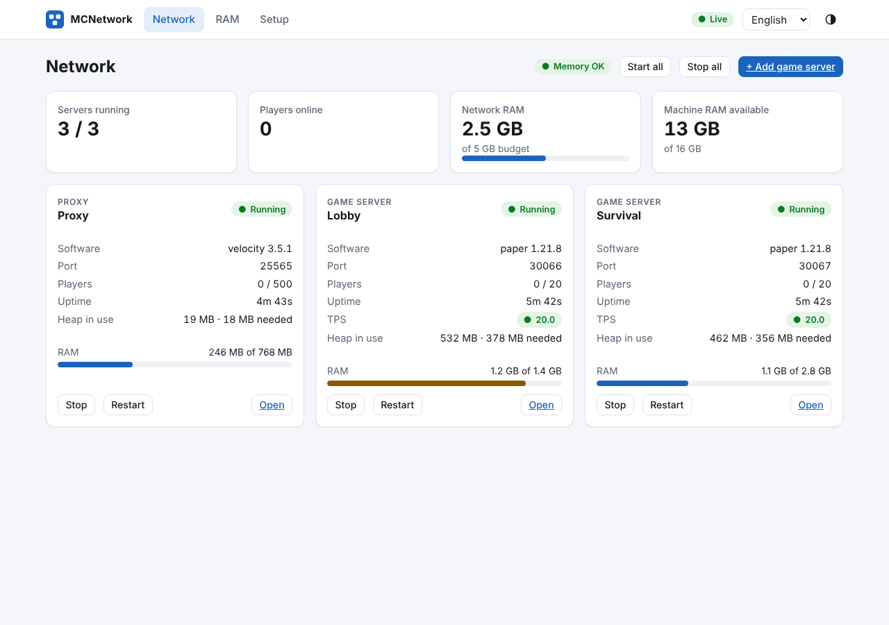
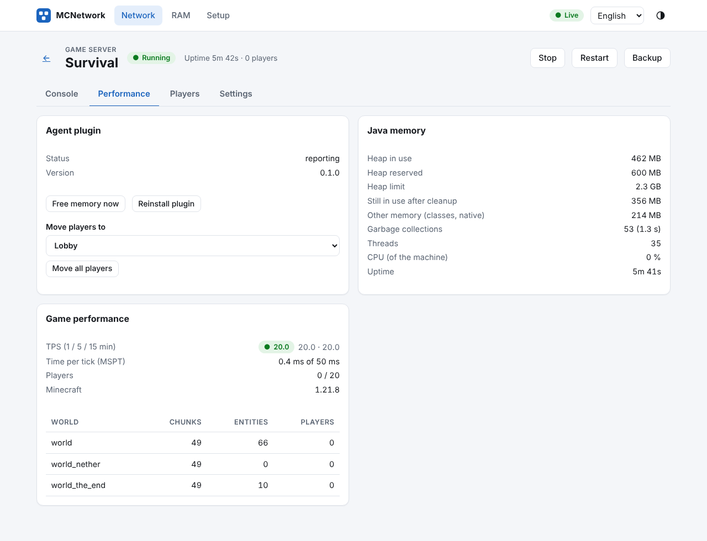
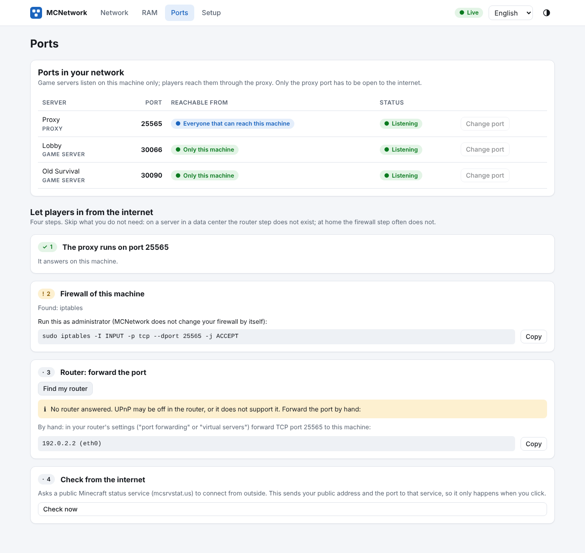
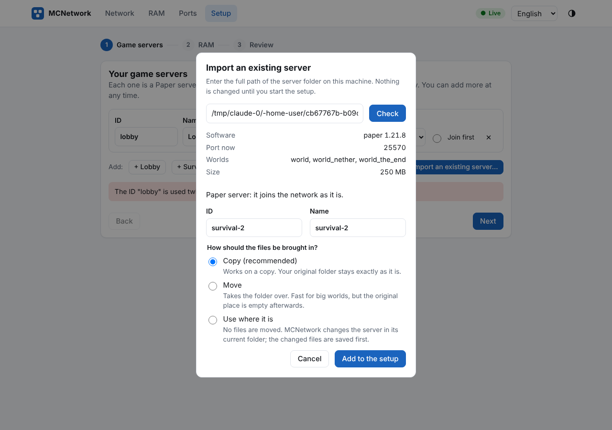

# MCNetwork

Management tool for Minecraft server networks: one proxy (Velocity) and several backend servers on one machine,
each controlled through [MCLI](https://github.com/F02K/MCLI), with RAM tracking and planning for the whole network.

**Status:** daemon, HTTP API, web dashboard, setup wizard, the Paper/Velocity plugins, import of existing servers and port management work. A terminal UI is next.



## What it does today

- **Web dashboard** (`http://localhost:8080`, English and German, light and dark): network overview, live console per server, player list, settings, backups, RAM chart with hover details and a table view.
- **Plugins that deliver themselves:** MCNetwork ships a Paper and a Velocity plugin ([agent/](agent/README.md)) and installs and configures them in every server, with no manual steps. They report real heap use, TPS, GC and players, and carry out orders: free memory now, or move all players of a server to another one (for example before a restart).
- **Bring your existing servers:** point MCNetwork at a server folder; it recognises Paper, Spigot, Fabric, Forge, Vanilla and Velocity, shows what it found (version, worlds, plugins, size, warnings) and brings it in - as a copy, moved, or used in place. Paper joins as it is; Spigot can be switched to Paper (world backed up first); software that cannot sit behind the proxy is managed on its own. Changed files are saved first.
- **Ports without the headache:** one page lists every port, who can reach it and what is wrong (double ports, a game server that players could reach around the proxy), changes a port in all the right files, and guides the proxy to the internet: firewall command for your system, router port forwarding with UPnP (kept open while MCNetwork runs), the address to hand out, and an optional check from the internet.
- **Setup wizard:** choose Velocity, add game servers (lobby, survival, …), see the RAM plan, confirm the Minecraft EULA, and MCNetwork builds the network:
  installs Velocity and Paper, lets each server write its settings once, then connects them (secure "modern" player forwarding with a shared secret,
  local-only backend ports, server list and join-first server in `velocity.toml`). Servers can be added to a running network later; the proxy is told to reload.

- Runs one MCLI process (`mcli --api`) per server and keeps it alive (restarts MCLI after a crash, then starts the server again).
- Starts the backends first and the proxy last; stops in the reverse order, gracefully.
- **RAM:**
  - samples the machine (container limit aware, Linux `MemAvailable`) and every server every few seconds, keeps 24 h of history;
  - plans the heap of every server from the RAM that is really available (`GET /api/ram/plan`) and writes it to the servers (`POST /api/ram/plan/apply`);
  - tells which running servers need a restart to use their new heap;
  - with the plugins: compares each server's heap with what it really needs (heap still in use after garbage collection) and suggests a smaller or larger one, applied with one click;
  - reports memory pressure (`ok` / `warn` / `critical`).
- REST API plus a live event stream (server-sent events), optional token.








## Quick start

Needs Node.js 22 or newer and a built `mcli.js` from MCLI (`npm run build` there). The plugin jars are included (`agent/jars`); rebuilding them needs a JDK and Maven (`npm run build:agent`).

```
npm ci
npm run build
node dist/mcnetwork.js --data ./data
```

On the first run `data/mcnetwork.json` is written. Set `mcliPath` to your `mcli.js` (or start with `MCLI_PATH=/path/to/mcli.js`), restart, and open
`http://localhost:8080` – the wizard takes it from there. Everything the dashboard does is also available over the [HTTP API](docs/API.md):

```
curl localhost:8080/api/ram/plan
curl -X POST localhost:8080/api/servers/lobby/restart
```

The dashboard files live in `web/` next to `dist/`; `--web <folder>` serves another folder.

Every server lives in `data/servers/<id>/`. Removing a server from the network never deletes its files.

## Configuration

`data/mcnetwork.json`:

```json
{
  "mcliPath": "mcli.js",
  "http": { "host": "127.0.0.1", "port": 8080, "token": "" },
  "ram": { "totalMb": 0, "reserveMb": 0, "sampleSeconds": 10 },
  "servers": [
    { "id": "proxy", "role": "proxy", "autoStart": true, "memory": {} },
    { "id": "survival", "role": "backend", "memory": { "weight": 8, "minMb": 2048 } }
  ]
}
```

| Key | Meaning |
| --- | --- |
| `http.host` / `http.token` | the API listens on loopback by default; any other address **requires** a token |
| `ram.totalMb` | RAM MCNetwork may plan with; `0` = detect (container limit or physical RAM) |
| `ram.reserveMb` | left for the OS; `0` = 12 % of the total, at least 1 GB |
| `memory.weight` | share of the RAM budget (default: proxy 1, backend 4) |
| `memory.minMb` / `maxMb` | limits for the heap (defaults: proxy 512-1024, backend from 512) |
| `memory.pinnedMb` | fixed heap, ignores the weight |
| `ports.upnp` | keep the proxy's port forwarded on the router with UPnP while MCNetwork runs |
| `agent.enabled` / `agent.token` | the plugins on or off; the secret they report with (generated on the first run) |
| `port` / `entry` | set by the wizard: the server's Minecraft port, and whether players join it first |

The game servers listen on `127.0.0.1` only (ports from 30066 up), so players can only reach them through the proxy.

## Importing existing servers

In the wizard (or when adding a game server) choose **Import an existing server...** and enter the folder. Nothing is changed until the setup runs.

| Found | What MCNetwork does |
| --- | --- |
| Paper (and forks such as Purpur) | joins the network as it is: local port, forwarding secret, plugin, entry in `velocity.toml` |
| Spigot / CraftBukkit | switched to Paper of the same version when you ask for it (the world is backed up first), otherwise managed on its own |
| Fabric, Forge, NeoForge, Vanilla | managed on its own (start, stop, backup, RAM, console): they cannot receive players from Velocity without extra mods |
| Velocity | your proxy is used: its port, message and servers stay, the network is added to it |

**How the files come in:** *copy* (default: your original stays exactly as it is), *move*, or *use in place*. Before MCNetwork changes `server.properties`, `config/paper-global.yml` or `velocity.toml` of an imported server, the originals are saved in `.mcnetwork-backup/<time>/` in that server's folder. Removing a server from the network never deletes its files.

**Good to know:** behind Velocity players are authenticated by the proxy, so a game server runs with `online-mode=false` and listens on `127.0.0.1` only. A server that used to run in offline mode (cracked) gets real Mojang UUIDs now, so existing player data may not match; the check warns about it.

## Ports and internet access

Open **Ports** in the dashboard.

- **Ports in your network:** every server's port, where it listens and whether it is up. It warns about the same port used twice, another program on a server's port, a proxy that only listens locally, and a game server that listens on every address (players could skip the proxy and its login check) with a one-click fix. *Change port* writes the new port into the server's own files and the proxy's list; the server must be stopped.
- **Let players in from the internet** (only the proxy port has to be open):
  1. the proxy runs;
  2. the **firewall**: MCNetwork finds `ufw`, `firewalld`, `iptables` or the Windows firewall and shows the exact command (it does not change your firewall itself);
  3. the **router**: *Find my router* uses UPnP; *Open port automatically* forwards the port and keeps it forwarded while MCNetwork runs (and gives it back when it stops, but opens it again at the next start). Without UPnP the page shows the manual steps with this machine's address. It also notices a provider-shared address (CGNAT), where forwarding cannot work;
  4. a **check from the internet** with a public status service (mcsrvstat.us). That sends your public address and the port to that service, so it only happens when you click.

## The agent plugins

They are installed when the daemon starts or installs software, and the daemon rewrites their config if its address or token changes. In the dashboard open a server and its **Performance** tab: heap, GC, TPS, world sizes, *Free memory now*, *Move all players*, and *Reinstall plugin*. If a plugin does not report, the tab says why. Set `agent.enabled` to `false` to run without them.

## About the Minecraft EULA

Paper servers need the [Minecraft EULA](https://aka.ms/MinecraftEULA) to be accepted. MCNetwork never does this on its own:
the wizard only continues after you tick the confirmation, and only then writes `eula.txt` through MCLI.

## How the RAM plan works

1. Budget = total RAM minus the reserve.
2. A JVM needs more than its heap (metaspace, JIT, threads, native buffers), so a heap of `H` is counted as `H + max(fixed, 15 %)` with a fixed part of 256 MB for the proxy and 512 MB for game servers (measured with real Velocity and Paper).
3. Pinned servers get exactly their size; the rest of the budget is shared by weight. A server that hits its minimum or maximum is fixed there and the others share what is left.
4. Proxies start with their full heap; backends start with a quarter of it (`-Xms`) and grow, so the JVM can give memory back.
5. If even the minimums do not fit, everyone gets the minimum and the plan carries a warning.

A running JVM cannot change its heap: new sizes apply at the next start of each server.

## API and architecture

See [docs/API.md](docs/API.md) for the HTTP API and [docs/ARCHITECTURE.md](docs/ARCHITECTURE.md) for how the pieces fit together and what is planned.

## Tested with real servers

The setup, the proxy connection (modern forwarding), joining through Velocity, switching servers and adding a server to a running network were verified with a real Velocity and real Paper servers. See [docs/E2E.md](docs/E2E.md).

## Development

```
npm run typecheck
npm run lint
npm test               # tests use a stand-in for MCLI (test/fake-mcli.ts)
npm run test:coverage
```
