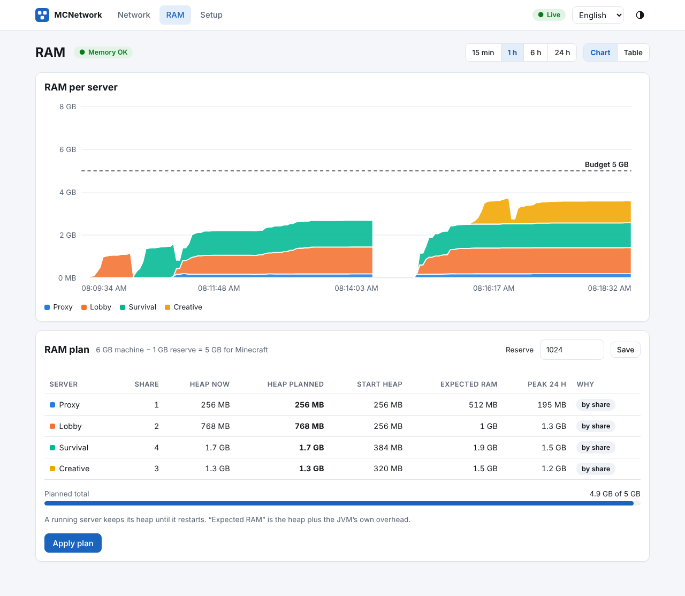

# MCNetwork

Management tool for Minecraft server networks: one proxy (Velocity) and several backend servers on one machine,
each controlled through [MCLI](https://github.com/F02K/MCLI), with RAM tracking and planning for the whole network.

**Status:** daemon, HTTP API, web dashboard and setup wizard work. Server plugins (real heap/TPS data) and a terminal UI are next.


## What it does today

- **Web dashboard** (`http://localhost:8080`, English and German, light and dark): network overview, live console per server, player list, settings, backups, RAM chart with hover details and a table view.
- **Setup wizard:** choose Velocity, add game servers (lobby, survival, …), see the RAM plan, confirm the Minecraft EULA, and MCNetwork builds the network:
  installs Velocity and Paper, lets each server write its settings once, then connects them (secure "modern" player forwarding with a shared secret,
  local-only backend ports, server list and join-first server in `velocity.toml`). Servers can be added to a running network later; the proxy is told to reload.

- Runs one MCLI process (`mcli --api`) per server and keeps it alive (restarts MCLI after a crash, then starts the server again).
- Starts the backends first and the proxy last; stops in the reverse order, gracefully.
- **RAM:**
  - samples the machine (container limit aware, Linux `MemAvailable`) and every server every few seconds, keeps 24 h of history;
  - plans the heap of every server from the RAM that is really available (`GET /api/ram/plan`) and writes it to the servers (`POST /api/ram/plan/apply`);
  - tells which running servers need a restart to use their new heap;
  - reports memory pressure (`ok` / `warn` / `critical`).
- REST API plus a live event stream (server-sent events), optional token.



## Quick start

Needs Node.js 22 or newer and a built `mcli.js` from MCLI (`npm run build` there).

```
npm ci
npm run build
node dist/mcnetwork.js --data ./data
```

On the first run `data/mcnetwork.json` is written. Set `mcliPath` to your `mcli.js` (or start with `MCLI_PATH=/path/to/mcli.js`), restart, and open
`http://localhost:8080` – the wizard takes it from there. Everything the dashboard does is also available over the [HTTP API](docs/API.md):

```
curl localhost:8080/api/ram/plan
curl -X POST localhost:8080/api/servers/lobby/restart
```

The dashboard files live in `web/` next to `dist/`; `--web <folder>` serves another folder.

Every server lives in `data/servers/<id>/`. Removing a server from the network never deletes its files.

## Configuration

`data/mcnetwork.json`:

```json
{
  "mcliPath": "mcli.js",
  "http": { "host": "127.0.0.1", "port": 8080, "token": "" },
  "ram": { "totalMb": 0, "reserveMb": 0, "sampleSeconds": 10 },
  "servers": [
    { "id": "proxy", "role": "proxy", "autoStart": true, "memory": {} },
    { "id": "survival", "role": "backend", "memory": { "weight": 8, "minMb": 2048 } }
  ]
}
```

| Key | Meaning |
| --- | --- |
| `http.host` / `http.token` | the API listens on loopback by default; any other address **requires** a token |
| `ram.totalMb` | RAM MCNetwork may plan with; `0` = detect (container limit or physical RAM) |
| `ram.reserveMb` | left for the OS; `0` = 12 % of the total, at least 1 GB |
| `memory.weight` | share of the RAM budget (default: proxy 1, backend 4) |
| `memory.minMb` / `maxMb` | limits for the heap (defaults: proxy 512-1024, backend from 512) |
| `memory.pinnedMb` | fixed heap, ignores the weight |
| `port` / `entry` | set by the wizard: the server's Minecraft port, and whether players join it first |

The game servers listen on `127.0.0.1` only (ports from 30066 up), so players can only reach them through the proxy.

## About the Minecraft EULA

Paper servers need the [Minecraft EULA](https://aka.ms/MinecraftEULA) to be accepted. MCNetwork never does this on its own:
the wizard only continues after you tick the confirmation, and only then writes `eula.txt` through MCLI.

## How the RAM plan works

1. Budget = total RAM minus the reserve.
2. A JVM needs more than its heap (metaspace, JIT, threads, native buffers), so a heap of `H` is counted as `H + max(fixed, 15 %)` with a fixed part of 256 MB for the proxy and 512 MB for game servers (measured with real Velocity and Paper).
3. Pinned servers get exactly their size; the rest of the budget is shared by weight. A server that hits its minimum or maximum is fixed there and the others share what is left.
4. Proxies start with their full heap; backends start with a quarter of it (`-Xms`) and grow, so the JVM can give memory back.
5. If even the minimums do not fit, everyone gets the minimum and the plan carries a warning.

A running JVM cannot change its heap: new sizes apply at the next start of each server.

## API and architecture

See [docs/API.md](docs/API.md) for the HTTP API and [docs/ARCHITECTURE.md](docs/ARCHITECTURE.md) for how the pieces fit together and what is planned.

## Tested with real servers

The setup, the proxy connection (modern forwarding), joining through Velocity, switching servers and adding a server to a running network were verified with a real Velocity and real Paper servers. See [docs/E2E.md](docs/E2E.md).

## Development

```
npm run typecheck
npm run lint
npm test               # tests use a stand-in for MCLI (test/fake-mcli.ts)
npm run test:coverage
```
